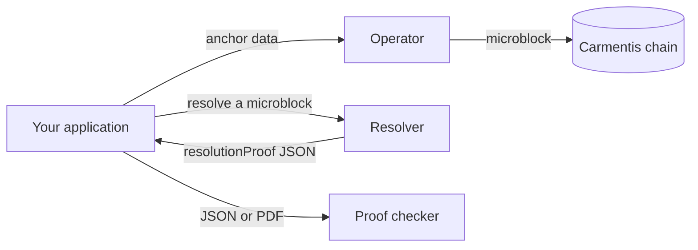

# Anchoring and resolution: overview

These guides explain how an application publishes data with its [operator](/operate/operator), how the published data can reference other data, and how everything is turned back into a single, verifiable result.

The running example is an **assignment of receivable** between three parties: the *assignor* (cédant), the *assignee* (cessionnaire) and the *debtor*.

## The big picture

1. Your application **anchors** data. Each anchoring produces a *microblock* in a virtual blockchain.
2. A microblock can contain **special keys** that point to other data: another microblock, off-chain data, a signed payload or a verifiable presentation.
3. Later, the **resolver** reads a microblock, follows every special key, and returns a `resolutionProof`: the fully resolved data, together with the proofs that back each part of it.
4. Anyone holding that `resolutionProof` can submit it to the **proof checker**, which verifies every proof and its consistency with the data.

## Special keys

A special key is an object field whose name starts and ends with a double underscore. The operator and the resolver give them a meaning.

| Key                      | You put it in anchored data to…                                         | Resolution result                                          | Guide                                              |
| ------------------------ | ----------------------------------------------------------------------- | ---------------------------------------------------------- | -------------------------------------------------- |
| `__link__`    | Reference another microblock.                                           | The referenced data replaces the link.                     | [Reference microblocks](./reference-microblocks)   |
| `__digest__`             | Anchor only the hash of data stored off-chain.                          | The plaintext replaces the digest, once checked.           | [Off-chain data](./off-chain-data)                 |
| `__digest_data__`        | Anchor the plaintext of off-chain data next to its link (re-anchoring). | The plaintext is checked against the referenced digest.    | [Off-chain data](./off-chain-data)                 |
| `__signature__`          | Anchor a payload signed by another operator.                            | The payload replaces the signature, once checked.          | [Signed data](./signed-data)                       |
| `__vp__`                 | Anchor a verifiable presentation.                                       | The credential claims replace the presentation.            | [Verifiable credentials](./verifiable-credentials) |

## Where to start

1. [Anchor data on-chain](./anchor-on-chain): the simplest method, and the basis of the others.
2. Pick the guides that match your needs (references, off-chain data, signatures, credentials).
3. [Resolve and check proofs](./resolution-and-proof-checker) to give your users something verifiable.
