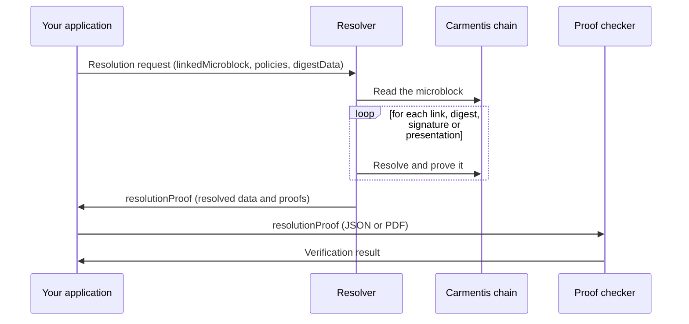

# Resolve and check proofs

**Resolving** a microblock follows all its references and returns an object with usable data, together with **all the associated proofs**. The **proof checker** then verifies that object.



## Example

We reuse the receivable that [references its debtor](./reference-microblocks). Its anchored data contains a link:

```json
{
  "applicationId": "...",
  "data": {
    "name": "Energy supply invoice",
    "reference": "F-2025-11873",
    "issuer": "EDF",
    "date": "2023-12-05",
    "principal": 358.2,
    "interest": 12.5,
    "debtor": {
      "__resolution_link__": "cmts://resolve/al/B304934D7D323D/h/123"
    }
  }
}
```

Suppose it was anchored in the microblock `cmts://resolve/al/A1480947BF02147CC62FE8163C/h/259`.

## The resolution request

The request sent to the resolver contains:

```json
{
  "linkedMicroblock": "cmts://resolve/al/A1480947BF02147CC62FE8163C/h/259",
  "policies": {
    "onResolutionFailure": "throw",
    "onCyclicResolution": "throw"
  }
}
```

| Field                           | Meaning                                                                                                                                                                           |
| ------------------------------- | --------------------------------------------------------------------------------------------------------------------------------------------------------------------------------- |
| `linkedMicroblock`              | The microblock to resolve.                                                                                                                                                        |
| `policies.onResolutionFailure`  | What to do if the resolution algorithm fails: `ignore` or `throw` (default `throw`).                                                                                              |
| `policies.onCyclicResolution`   | What to do if a cycle is detected in the references: `ignore` or `throw` (default `throw`). Cycles cannot appear if links only reference microblocks that existed at anchoring time. |
| `digestData`                    | Optional. The clear [off-chain data](./off-chain-data) to match against the anchored digests.                                                                                    |

The policies are optional, and define the behavior of the resolver.

## The resolution proof

The resolver resolves every link recursively. Each time a link is resolved, its proof is added to the returned proofs. The result is:

```json
{
  "type": "resolutionProof",
  "info": {
    "version": 1,
    "chainId": "",
    "description": "Resolution proof",
    "author": "Operator",
    "date": "2026-10-05"
  },
  "proof": {
    "linkedMicroblock": "cmts://resolve/al/A1480947BF02147CC62FE8163C/h/259",
    "resolvedMicroblock": {
      "name": "Energy supply invoice",
      "reference": "F-2025-11873",
      "issuer": "EDF",
      "date": "2023-12-05",
      "principal": 358.2,
      "interest": 12.5,
      "debtor": { "lastName": "Durand", "firstName": "Pierre" }
    },
    "proofs": {}
  },
  "proofSignature": {}
}
```

| Field                         | Meaning                                                                                                                            |
| ----------------------------- | ---------------------------------------------------------------------------------------------------------------------------------- |
| `type`                        | The type of proof: `resolutionProof`.                                                                                              |
| `info.version`                | Version of the proof format.                                                                                                       |
| `info.chainId`                | Id of the chain of the resolved microblock.                                                                                        |
| `info.description`, `author`  | A description and the author of the proof.                                                                                         |
| `info.date`                   | Generation date, in ISO format.                                                                                                    |
| `proof.linkedMicroblock`      | The microblock that was resolved (here, the receivable).                                                                           |
| `proof.resolvedMicroblock`    | The resolved data, with every link, digest, signature and presentation replaced by its content.                                    |
| `proof.proofs`                | The authenticity proofs for every resolved link: here the receivable's microblock and the debtor's microblock.                     |
| `proof.digestData`            | Present when [off-chain data](./off-chain-data) was resolved.                                                                       |
| `proofSignature`              | Optional signature of the proof.                                                                                                   |

`proofs` is shown empty above for brevity. In a real proof it contains one authenticity proof per resolved microblock.

The resolver thus gives you all the anchored data along with its proofs.

## Use the proof checker

Send the resolution proof to the proof checker:

- directly as **JSON**; or
- as a **PDF** with the JSON attached.

The proof checker verifies **all the proofs**, and their **consistency** with the data in `resolvedMicroblock`.

## What can resolve

| Anchored key                                           | Checked at resolution                                          |
| ------------------------------------------------------ | -------------------------------------------------------------- |
| [`__resolution_link__`](./reference-microblocks)       | The referenced microblock exists and is proven.                |
| [`__digest__`](./off-chain-data)                       | The supplied clear data matches the anchored digest.           |
| [`__signature__`](./signed-data)                       | The signature over the payload is valid.                       |
| [`__vp__`](./verifiable-credentials)                   | The presentation is valid; its claims are returned.            |
