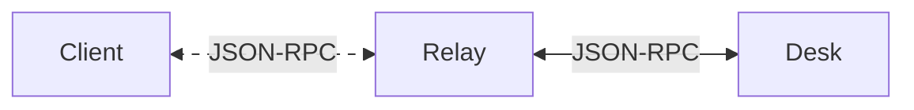
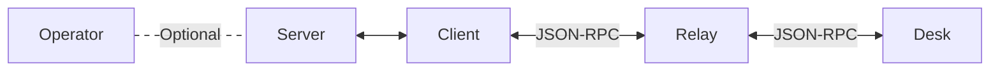

# Interact with Desk

When running your application, you might need to interact with an end-user and thus with its desk.

## Overview of communications workflow

### Focus on client-to-desk communication workflow

In theory, a client application can directly interact with a desk by sending JSON-RPC requests
through carmentis-provided relays. The general workflow is as follows:



Let's focus on a simple example authentication request sent by a client to desk,
used to authenticate a user by its public signature key.

```html

<!-- This example requires the desk-connect-js library bringing all the necessary dependencies. -->
<script src="https://unpkg.com/@cmts-dev/carmentis-desk-connect-js@1.1.0/dist/index.umd.cjs"></script>
<script type="module">
    // CarmentisConnect is exported by carmentis-desk-connect-js
    const popup = CarmentisConnect.createCarmentisJsonRpcPopup({
        // Indicates the relay to use between this app and desk.
        // There is no need to fully trust the relay (only semi-trusted relays are enough) has
        // all data are AEAD-encrypted before being sent to desk through the relay.
        // Of course, you are free to run your own relay (see https://github.com/Carmentis/carmentis-relay)
        // and use it instead of the one provided by Carmentis.
        // A relay is blockchain-independent (do not care about the 'testnet' in the relay URL). 
        relayUrl: 'https://relay.testnet.carmentis.io',

        // Indicates the title of the popup.
        title: 'Authenticate with Carmentis Desk',
        
        // The JSON-RPC request to send to desk.
        // The `method` field is the name of the JSON-RPC method to call.
        // The `params` field is the parameters to pass to the method.
        request: { 
            jsonrpc: '2.0',
            id: 1,
            method: '/v2/auth/pk',
            params: {
                // the origin of your application, shown to the user
                origin: 'https://your-app.example.com',
                // the title shown to the user
                title: 'Log in to Your App',
                // a challenge, ideally generated by your server
                challenge: 'dGVzdA==',
            },
        },

        // handler for the response
        onResponse(response) {
            // response.result contains the public key and the signature
            console.log('Success:', response.result);
            popup.close();
        },

        // handler for the error
        onError(err) {
            console.error('JSON-RPC error:', err.message);
            popup.close();
        },

        // handler for the popup close
        onClose() {
            console.log('Popup dismissed');
        },
    });

    // display the authentication request
    await popup.open();
</script>
```
The [carmentis-desk-connect-js](https://github.com/Carmentis/carmentis-desk-connect-js) library
provides a simple API and uses a privacy-friendly relay client, also put in place in Desk. Therefore,
every communication between a client and a desk is encrypted and authenticated.


:::info Carmentis Desk Connect for Vue.js
You can also use the [carmentis-desk-connect-vue](https://github.com/Carmentis/carmentis-desk-connect-vuejs) library
to interact with Desk in a Vue.js application.
:::

### Full server-to-desk communication workflow

While being achievable, you may not want the client (i.e., the webpage) to generate
a challenge to be signed by the Desk of your user, but rather to use a challenge already generated by your server.
Your server can obtain one from the operator (see the [`/crypto/challenge` endpoint](/operate/operator)) and transfer it to the client before running the client-to-desk workflow.


When Desk receives a request through the `cmts://` link opened by the popup, it comes to the front and shows the request.
**Nothing is signed or returned until the user approves it**, by choosing the wallet to use and clicking *Approve*. Each session serves a single request.

## Supported JSON-RPC requests

These are the requests supported by the latest release of [Desk](https://github.com/carmentis/carmentis-desk).

:::warning Beta development
Remember that *all methods and parameters* are subject to change at any time.
:::

| Method | Purpose |
| ------ | ------- |
| [`/v2/auth/pk`](#v2authpk) | Authenticate the user by a signature of a challenge. |
| [`/v1/auth/pk`](#v1authpk) | Authenticate the user by a signature of a challenge (earlier version). |
| [`/v1/sign/json`](#v1signjson) | Sign a JSON payload. |
| [`/v1/credential/presentation`](#v1credentialpresentation) | Present a verifiable credential. |

Desk also answers two utility methods: `ping`, which returns `{ ts }`, and `discover`, which returns the list of supported methods.
A request with an unknown method gets the error `-32601`, and one with invalid parameters the error `-32602`.

For every method, a `publicKey` parameter may be given to preselect the wallet that matches this public key.
Otherwise, the user picks the wallet in the approval window.

### `/v2/auth/pk`

Authenticates a user by their public signature key.

| Parameter | Description |
| --------- | ----------- |
| `origin` | The origin (your application) requesting the authentication. Shown to the user. |
| `title` | Optional. The purpose, shown to the user. Defaults to "Authentication Request". |
| `logoUrl` | Optional. The logo of your application, shown to the user. |
| `challenge` | The challenge to sign. |
| `publicKey` | Optional. The public key of the wallet to use. |

The result contains `pk` (the public key, as in `SIG:SECP256K1:PK{...}`), `publicKey` and `signature`.

The signature is made on the challenge together with a context stating the target (`origin`), the purpose (`title`), the signature time and a validity of 5 minutes. The signature is not meant to be used on-chain.

### `/v1/auth/pk`

Same goal as `/v2/auth/pk`.

| Parameter | Description |
| --------- | ----------- |
| `origin` | The origin requesting the authentication. |
| `title` | Optional. The title shown to the user. |
| `challenge` | The challenge to sign. |
| `sigEncoding` | Optional. The encoding of the signature: `base64` (default) or `hex`. |
| `publicKey` | Optional. The public key of the wallet to use. |

The result contains `pk`, `publicKey`, `signature` and `payload`. The signature is made on the canonical JSON of the payload, which contains the challenge (`sub`), the public key (`iss`), the origin (`aud`), the issue time (`iat`) and an expiry 60 seconds later (`exp`).

### `/v1/sign/json`

Signs a JSON document.

| Parameter | Description |
| --------- | ----------- |
| `payload` | The JSON to sign. |
| `context.purpose` | The purpose of the signature. The user can edit it before approving. |
| `context.allowedOnChain` | Optional. When set, the user can choose whether the signature may be used on-chain. |
| `publicKey` | Optional. The public key of the wallet to use. |

The result is `{ signature }`.

### `/v1/credential/presentation`

Asks the user to present a [verifiable credential](/use/credentials).

| Parameter | Description |
| --------- | ----------- |
| `audience` | The audience of the presentation. |
| `nonce` | A nonce, bound to the presentation. |
| `query` | A [DCQL](https://openid.net/specs/openid-4-verifiable-presentations-1_0.html#name-digital-credentials-query-l) query. Only one credential entry is supported. |
| `publicKey` | Optional. The public key of the wallet to use. |

The user sees the matching credentials and the claims to be revealed. The result is `{ vp_token }`, a presentation of the credential bound to the user's key.

If the user declines, Desk closes the session without sending an answer.
