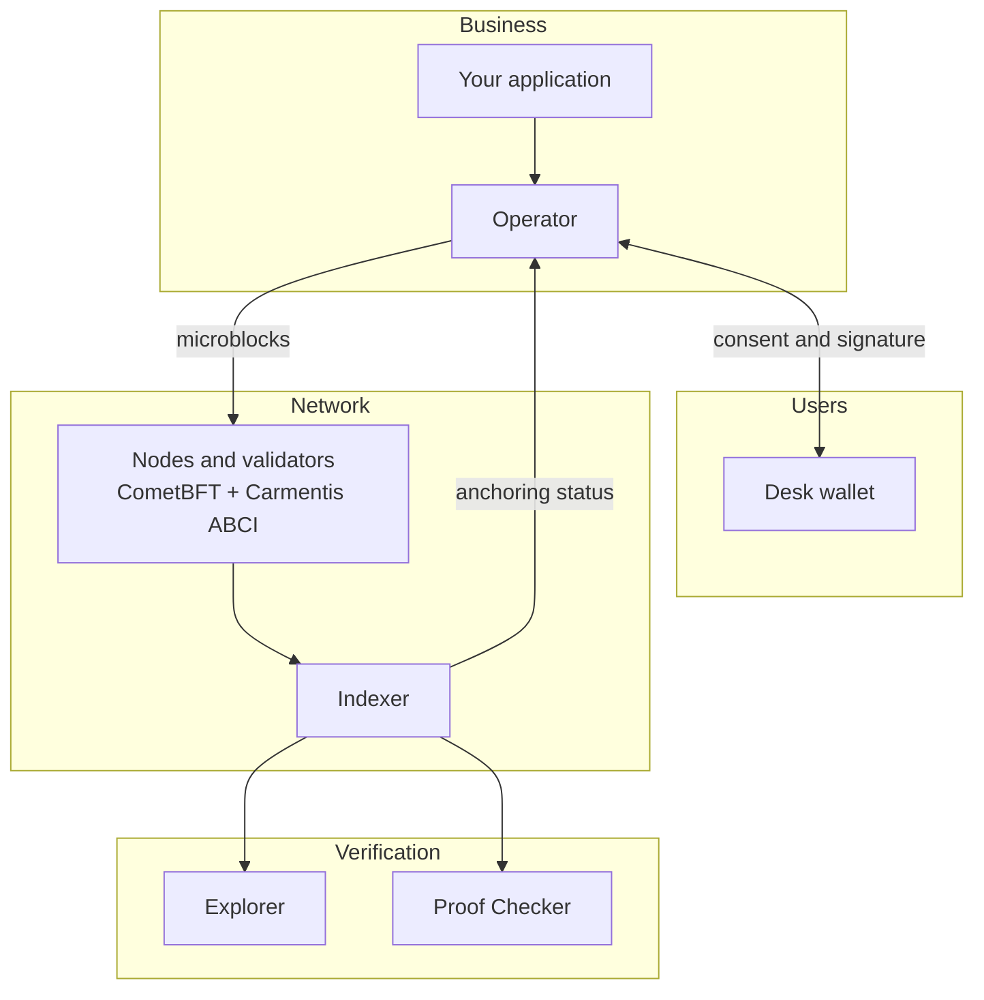

# Why Carmentis

Digital fraud is a top global risk: documents are forged, identities are spoofed and records are altered after the fact. Carmentis is a **proof blockchain**. It anchors structured, signed, timestamped and encrypted data, then lets anyone prove the authenticity of all or part of that data, without revealing the rest.

The network runs on [CometBFT](https://cometbft.com/) with an ABCI application written in TypeScript. Businesses connect through an **Operator** server, and users through their wallet, **Desk**.

<a href="/getting-started">Get started</a>
<a href="/concepts/overview">Technical overview</a>

## What Carmentis does

| Verb | What it means in Carmentis |
| :--- | :--- |
| **Authenticate** | A user signs a challenge with their wallet key. No password is involved. |
| **Identify** | Anchor and resolve SD-JWT verifiable credentials and presentations, and X.509 certificates. |
| **Sign** | A wallet signs canonical JSON (or JWS). The signature is anchored and verified when the data is resolved. |
| **Pay** | CMTS accounts support transfers, vesting, escrow and staking. |
| **Prove** | Merkle proofs of selective authenticity, resolution proofs and an online Proof Checker. |

## Benefits

### Prove without trusting the producer
A Carmentis proof is a self-contained JSON file. Anyone can verify it against the public chain, *without going through the company that produced it*. Reading the chain is free, and the [Proof Checker](/build/guides/anchoring/resolution-and-proof-checker) is open source and can be self-hosted. Verification never depends on Carmentis.

### Share only what you intend to share
Carmentis rejects "all or nothing". Within the same file, each party reads only the channels that concern it. Later, you can prove a subset of the data, such as a single field, without revealing the rest.

### Confidentiality by design
Private channel data is encrypted before it reaches the chain. Neither validators nor Carmentis can read it, and public replication of the chain does not compromise confidentiality.

### Password-free authentication
Identity is centred on the public key. A user proves who they are by signing a challenge in Desk, which removes passwords and the risks that come with them.

### Privacy-friendly and GDPR-aware
Personal data can stay off-chain: you anchor only a salted fingerprint. Erasing the off-chain data satisfies the right to erasure, because only the fingerprint remains on chain. Virtual blockchains can also expire after a chosen retention period.

:::note
The right to rectify data that has already been anchored is not covered.
:::

### Future-proof cryptography
Carmentis is **crypto-agile**. Every key and signature carries the identifier of its scheme, and every application ledger declares the schemes it accepts. Post-quantum algorithms such as ML-DSA-65 and ML-KEM-768 are supported alongside secp256k1 and Ed25519. JWK keys give native integration with decentralized identifiers (`did:jwk`). New algorithms can be added without breaking existing data.

### Predictable, transparent costs
Fees depend only on the signed content of the microblock: its size, the requested retention period and the signature scheme. The fee formula is versioned in the protocol, so it evolves through an explicit, traceable update.

### Open source and open infrastructure
The code is public on [GitHub](https://github.com/Carmentis), and anyone can build their own explorer, indexer or checker.

## Architecture at a glance

A single physical blockchain carries many **virtual blockchains**, much as one machine hosts many virtual machines. Each business object (an account, an organization, a customer file) has its own virtual blockchain, so its history can be read and verified independently. A virtual blockchain is a chain of **microblocks**, the smallest unit of data that can be anchored.

A business never talks to the chain directly. Its application goes through the Operator, which obtains the user's consent through their wallet and then broadcasts the microblock to the nodes. Verification, on the other hand, requires nobody's consent.

| Component | Role |
| :--- | :--- |
| **Nodes and validators** | Each node combines CometBFT (consensus, networking, finality) with the Carmentis ABCI application, which enforces the business rules. Validators are declared on chain, approved, and can be penalized (slashing). |
| **Operator** | A server deployed by each business. It signs as the microblock author, pays the fees, encrypts the channels and distributes the keys. |
| **Desk** | The desktop wallet. It signs, approves requests, stores credentials and manages nodes. Websites reach it through an end-to-end encrypted relay. |
| **Indexer** | Indexes the chain, confirms anchorings to the Operator and computes validator rewards. |
| **Explorer and Proof Checker** | Read-only tools for inspecting the chain and verifying proofs independently. |
| **Protocol governance** | Global parameters, such as fee formulas and state-update rules, live in a Protocol virtual blockchain and change through versioned updates. |

### A traceable chain of responsibility
Identity follows a hierarchy: an **account** holds a key and a balance, an **organization** is created from an account, and an **application** is declared by an organization. Each concrete use of an application opens an **application ledger**. A verifier can trace any anchored data back to the application, then to the organization operating it, then to the account that paid for it.

For each application ledger, the wallet derives a distinct key pair. An outside observer therefore cannot link the same user across two application ledgers.

### Public and private channels
Participants in an application ledger are **actors**, and data lives in **channels**. A public channel is readable and verifiable by everyone. A private channel is encrypted with AES-256-GCM and readable only by invited actors. Each field is a leaf of a salted Merkle tree, which is what makes selective disclosure possible.

## Where Carmentis fits

Carmentis is a format-neutral proof layer that complements existing infrastructure. It is not a settlement rail.

| Family | What Carmentis brings |
| :--- | :--- |
| Authenticate, identify, comply | Key-based identity, verifiable credentials and an evidential audit trail |
| Track and prove | Integrity of documents that evolve in a multi-party workflow |
| Exchange trusted data | Controlled sharing in regulated environments such as finance, health, defence and justice |
| Intellectual property and product passports | Rights-holder management and Digital Product Passports |
| Corporate identity | vLEI credentials and card-based signing |

Several features map directly to regulatory requirements: a timestamped, ordered ledger and SD-JWT credentials for eIDAS 2, hashed off-chain data and selective disclosure for GDPR, and BFT consensus with post-quantum cryptography for DORA and NIS2.

:::caution
Compliance with eIDAS 2 as a qualified electronic ledger is not yet achieved. It is on the roadmap.
:::

## Token and economics

Operators pay transaction fees in **CMTS**, the native utility token. Fees are redistributed to validators, who must stake CMTS to operate. Validator rewards are paid by an off-chain incentive programme. See the [token economy](https://assets.carmentis.io/token-economy) for details.

## Learn more

<a href="/getting-started">Get started</a>
<a href="/concepts/overview">Technical overview</a>
<a href="/resources/glossary">Glossary</a>
<a href="https://assets.carmentis.io/whitepaper.pdf" target="_blank">Whitepaper</a>
<a href="https://assets.carmentis.io/token-economy.pdf" target="_blank">Token economy</a>

