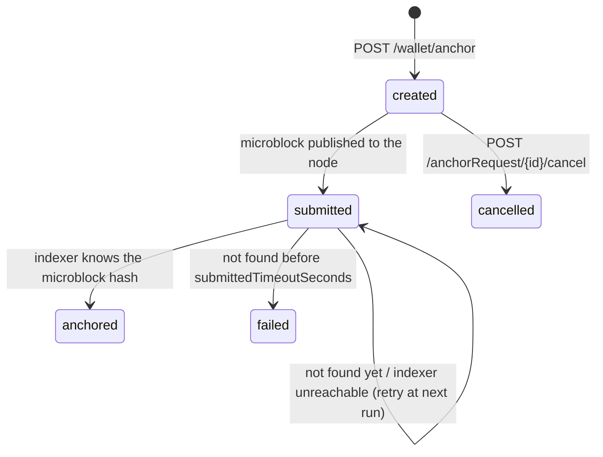

# Carmentis Operator

The **Carmentis Operator** is a self-hosted server that sits between your applications and the Carmentis blockchain. Your application talks to the Operator over a simple, documented HTTP API; the Operator takes care of everything blockchain-specific: building and signing microblocks, publishing them to a node, tracking their confirmation through an indexer, and producing proofs.

```text
┌─────────────┐  HTTP + API key  ┌──────────────┐   RPC    ┌────────────────┐
│ Your        │ ───────────────► │   Operator   │ ───────► │ Carmentis node │
│ application │ ◄─────────────── │              │          └────────────────┘
└─────────────┘                  │  - wallets   │  HTTP    ┌────────────────┐
                                 │  - API keys  │ ───────► │    Indexer     │
                                 │  - database  │
                                 │  - admin UI  │
                                 └──────────────┘
```

## Why use the Operator?

Publishing data on a blockchain directly means handling keys, key derivation, microblock construction, signatures, gas, node communication and confirmation tracking. The Operator packages all of this behind a few endpoints.

| You want to…                                              | The Operator gives you…                                                              |
| --------------------------------------------------------- | ------------------------------------------------------------------------------------ |
| Anchor business data on-chain                             | A single `POST` to create an *anchor request*, then a status endpoint to follow it    |
| Keep private keys out of your application                 | Wallets managed (and encrypted at rest) by the Operator                              |
| Control who can publish what                              | Scoped, revocable **API keys** (per application, endpoint regex, gas limits, expiry)  |
| Prove that data is authentic and on-chain                 | Proof, record and "is published" endpoints                                           |
| Verify credentials and signatures                         | Verification endpoints for SD-JWT credentials/presentations and signatures           |
| Administrate everything without writing code              | A built-in web admin UI                                                              |

## Core concepts

- **Organization**: the legal/logical entity that owns applications on the Carmentis blockchain.
- **Application**: an application registered on-chain under an organization. Anchored data is always published *for* an application (identified by its virtual blockchain id, `applicationId`).
- **Wallet**: the key material the Operator uses to sign and pay for publications. Each wallet is configured with:
    - an **RPC endpoint**, the Carmentis node to publish to;
    - an **indexer endpoint**, used to read the chain state and confirm publications;
    - optionally an allowed-endpoints regex.

  Sensitive values (such as the wallet passphrase and API keys) are encrypted in the database.
- **API key**: the credential your application sends to the Operator. A key can be bound to an application and/or a wallet, restricted to endpoints matching a regex, limited to a gas range, given an expiry date, and deactivated at any time.
- **Anchor request**: a request to publish data on-chain. It is created by your application and tracked by the Operator until it is confirmed.

## Anchor request lifecycle

Every anchor request has a status, exposed by the API:

| Status       | Meaning                                                                                                    |
| ------------ | ---------------------------------------------------------------------------------------------------------- |
| `created`    | The request exists and has not been published yet.                                                         |
| `submitted`  | The microblock has been published to the node. Its presence on chain is **not yet confirmed**.            |
| `anchored`   | The indexer has confirmed that the microblock is on chain.                                                 |
| `cancelled`  | The request has been cancelled before being submitted.                                                     |
| `failed`     | The microblock was submitted but never showed up in the indexer within the configured delay.               |

`anchored`, `cancelled` and `failed` are final states: a request never leaves them.



### Automatic confirmation

A background job periodically looks at every `submitted` request and asks the wallet's indexer whether the microblock hash is known:

- **found** → the request becomes `anchored`;
- **not found yet** → it stays `submitted` and is checked again at the next run;
- **not found after the timeout** → it becomes `failed`;
- **indexer unreachable** → the request is left untouched and retried later.

Both the frequency and the timeout are configurable (see [`[operator.anchoring]`](#anchoring)). Your application should therefore poll the status endpoint and treat `anchored` as the final success state.

## Quick start

### 1. Prerequisites

- Node.js 22+ and [pnpm](https://pnpm.io/) (or Docker)
- A reachable Carmentis node and indexer
- Optionally PostgreSQL or MySQL (SQLite is used by default)

### 2. Run it

**With Docker**

```bash
docker run --rm --name carmentis-operator \
  -p 3000:3000 \
  -v "$(pwd)/config.toml:/app/config.toml" \
  ghcr.io/carmentis/operator
```

**From source**

```bash
git clone https://github.com/carmentis/operator.git
cd operator
pnpm install
cp example-config.toml config.toml
pnpm build
pnpm start:prod        # or: pnpm start:dev
```

The API is served under `http://localhost:3000/api/v1/…`, the interactive Swagger documentation under `/swagger`, and the admin UI under `/admin`.

### 3. Initial setup

1. On first start, the Operator generates an admin initialization token (written to `operator/admin-token.txt` by default). Open `/admin/setup` and use it to create the first administrator.
2. Further administrators can be added with **invitation links** from the admin UI.
3. In the admin UI, create (or import):
    1. a **wallet** (with its RPC and indexer endpoints),
    2. an **organization**,
    3. an **application**, then publish them on-chain if they are new,
    4. an **API key**, optionally scoped to the application.

   If you already created the wallet in Carmentis Desk, export it to a password-protected `.ecw` file and import it from the **Wallets** page of the admin UI, see [Export and import a wallet](/use/wallets#export-and-import-a-wallet).

   The API key is displayed once at creation: copy it.

### 4. Anchor your first data

Send the API key in the `x-api-key` header.

```bash
curl -X POST http://localhost:3000/api/v1/wallet/anchor \
  -H "x-api-key: <your-api-key>" \
  -H "Content-Type: application/json" \
  -d '{
    "applicationId": "6AC2A4EBFD08F34C2EF4432041313F83EB4C8AB9154FAEF61ABB833613DA1C10",
    "chainStorageInDays": 360,
    "gasPriceInAtomics": 200000,
    "channels": [{ "name": "Public", "public": true }],
    "actors": [{ "name": "Issuer" }],
    "data": { "invoice_id": "INV-001", "amount": 1000, "customer": "ACME Corp" },
    "channelAssignations": [{ "channelName": "Public", "fieldPath": "this.*" }],
    "actorAssignations": [{ "actorName": "Issuer", "channelName": "Public" }],
    "author": "Issuer"
  }'
# → { "anchorRequestId": "..." }
```

Then follow the request:

```bash
curl -H "x-api-key: <your-api-key>" \
  http://localhost:3000/api/v1/anchorRequest/<anchorRequestId>/status
# → { "status": "submitted", "virtualBlockchainId": "...", "submittedMicroblockHash": "..." }
# … a little later:
# → { "status": "anchored", ... }
```

To append to an existing ledger instead of creating a new one, pass its `virtualBlockchainId` in the body.

## Anchoring endpoints

Your own backend publishes data with the Operator's wallet; no user interaction is needed.

| Endpoint                                                                  | Description                                                             |
| ------------------------------------------------------------------------- | ----------------------------------------------------------------------- |
| `POST /api/v1/wallet/anchor`<br />`POST /api/v1/wallet/{walletId}/anchor` | Create an anchor request signed by the Operator's wallet.               |

See [Anchor data on-chain](/build/guides/anchoring/anchor-on-chain) for the request body, and [Anchoring and resolution](/build/guides/anchoring/overview) for references, off-chain data and proofs.

The `/wallet/…` form without `{walletId}` uses the wallet associated with the API key or the application. All endpoints check that the API key may publish to the requested application and that the gas price is within the key's limits.

:::note Anchoring with the user's wallet is temporarily removed
The "anchor with wallet" flow (`anchorWithWallet`), in which an end user approves a publication from their own wallet, has been officially removed and is being reworked. Do not build new integrations on it.
:::

## API overview

All public endpoints live under `/api/v1`. Authenticated endpoints expect the `x-api-key` header; the exact schemas are available in the Swagger UI (`/swagger`).

### Anchor requests

| Method   | Path                                                  | Description                                                  |
| -------- | ----------------------------------------------------- | ------------------------------------------------------------ |
| `GET`    | `/anchorRequest`                                      | List anchor requests.                                        |
| `GET`    | `/anchorRequest/{id}`                                 | Get an anchor request.                                       |
| `GET`    | `/anchorRequest/{id}/status`                          | Status, virtual blockchain id and microblock hash.           |
| `GET`    | `/anchorRequest/{id}/published`                       | Whether the request is published on chain.                   |
| `GET`    | `/anchorRequest/{id}/proof/authenticity`              | Authenticity proof (for `submitted` / `anchored` requests).  |
| `POST`   | `/anchorRequest/{id}/cancel`                          | Cancel a request.                                            |
| `DELETE` | `/anchorRequest/{id}`                                 | Delete a request.                                            |

### Wallet

| Method | Path                                                         | Description                                          |
| ------ | ------------------------------------------------------------ | ---------------------------------------------------- |
| `GET`  | `/wallet/{walletId}/record`                                  | Read a record from a virtual blockchain.             |
| `GET`  | `/wallet/{walletId}/proof/authenticity`                      | Authenticity proof for a virtual blockchain.         |
| `GET`  | `/crypto/wallet/{walletId}/signature/pk`                     | Wallet public signature key.                         |
| `GET`  | `/crypto/wallet/{walletId}/actor/signature/pk`               | Actor public signature key.                          |
| `GET`  | `/crypto/wallet/{walletId}/actor/pke/pk`                     | Actor public encryption key.                         |
| `POST` | `/crypto/wallet/…`                                           | Sign a binary message or a JSON payload with the wallet key. |
| `POST` | `/crypto/wallet/{walletId}/json-signature/verify` and siblings | Verify binary / JSON signatures against the wallet key. |

### Chain, crypto helpers and credentials

| Method | Path                                                         | Description                                                   |
| ------ | ------------------------------------------------------------ | ------------------------------------------------------------- |
| `GET`  | `/chain/microblock/{hash}/published?nodeEndpoint=…`          | Check that a microblock is published on a given node.         |
| `GET`  | `/chain/applicationLedger/{vbId}/state?nodeEndpoint=…`       | Actors and channels of an application ledger.                 |
| `GET`  | `/chain/applicationLedger/{vbId}/actor/{name}/pk?nodeEndpoint=…` | Public keys of an actor.                                  |
| `POST` | `/crypto/signature/…`, `/crypto/signature/json-signature/verify` | Verify binary / JSON signatures.                          |
| `GET`  | `/crypto/challenge`, `/crypto/nonce`, `/crypto/uuid`         | Generate a challenge, a nonce or a UUID.                      |
| `POST` | `/vc/sdjwt/verify`, `/vp/sdjwt/verify`                       | Verify an SD-JWT verifiable credential / presentation.        |

### Health

| Method | Path                        | Description                   |
| ------ | --------------------------- | ----------------------------- |
| `GET`  | `/health`                   | Operator health check.        |
| `GET`  | `/public/hello`             | Public liveness endpoint.     |

## Admin UI

The admin UI (`/admin`) is a server-rendered web interface to configure the Operator:

- **Wallets**: create from a passphrase or seed, set RPC and indexer endpoints, view the on-chain account and token balance breakdown.
- **Organizations** and **Applications**: create, import existing ones, discover those already known to the indexer, publish them on-chain.
- **API keys**: create, edit, enable/disable and delete keys, with scoping (application, wallet, endpoint regex, gas range, expiry).
- **Users and invitations**: manage administrators.
- **Authentication**: login with a Carmentis Desk wallet challenge.

## Configuration

The Operator reads a **TOML** file. It uses the first file found among:

1. the path in the `CONFIG` (or `OPERATOR_CONFIG`) environment variable;
2. `config.toml`, `operator-config.toml` or `config-operator.toml` in the working directory.

Every option has a default, so a minimal setup needs almost nothing. The full template is [`example-config.toml`](https://github.com/carmentis/operator/blob/main/example-config.toml).

```toml
[operator]
# port = 3000

# SQLite is used by default. For PostgreSQL:
# [operator.database.postgresql]
# user = "your_username"
# password = "your_password"
# database = "your_database_name"
# url = "localhost"
# port = 5432
```

### Anchoring

```toml
[operator.anchoring]
# Cron expression: how often submitted anchor requests are checked against the indexer.
checkCronExpression = "* * * * *"   # default: every minute

# Seconds after which a submitted request still unknown to the indexer is marked `failed`.
submittedTimeoutSeconds = 600       # default: 10 minutes
```

Choose `submittedTimeoutSeconds` according to your own tolerance: too short and a slow indexer can cause false `failed` results; too long and failures are detected late.

### Main options

| Section                    | Purpose                                                                    |
| -------------------------- | -------------------------------------------------------------------------- |
| `[operator]`               | `port`, `dev` mode.                                                        |
| `[operator.admin.*]`       | JWT secret and validity, Carmentis Desk relay URL, invitation validity.    |
| `[operator.anchoring]`     | Confirmation job frequency and failure timeout.                            |
| `[operator.swagger]`       | Path of the Swagger UI.                                                    |
| `[operator.cors]`          | Allowed origins and methods.                                               |
| `[operator.database.*]`    | SQLite / PostgreSQL / MySQL, and at-rest encryption settings.              |
| `[operator.protocols.wap]` | Version of the Wallet Authentication Protocol.                             |
| `[operator.paths]`         | Home directory and location of the token, JWT secret and encryption key files. |

> **Keep the generated secrets safe.** If you let the Operator generate the database encryption key, back up `db-encryption-key.txt`: without it, encrypted values (wallet passphrases, API keys) cannot be read.

## Security notes

- Treat API keys like passwords: scope them to a single application, restrict `endpointRegex`, bound the gas range, set an expiry, and revoke unused keys.
- Run the Operator behind HTTPS (reverse proxy) and restrict `cors.origin` in production.
- Wallet passphrases and API keys are encrypted in the database; protect the database **and** the encryption key.
- Restrict network access to the admin UI (`/admin`).

## Further resources

- Swagger UI: `http://<operator-host>:<port>/swagger`
- Source code and issues: [https://github.com/carmentis/operator](https://github.com/carmentis/operator)
- License: Apache-2.0
